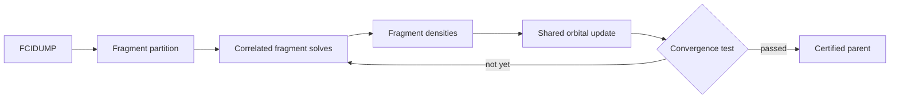
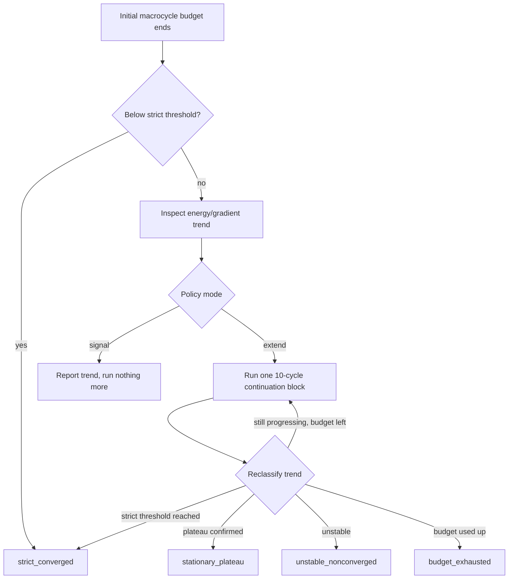

# The FRASCI Parent

This document explains `frasci.parent` for a reader who knows basic quantum
chemistry (orbitals, determinants, the electronic Hamiltonian) but has never
looked at this code. It avoids implementation details and focuses on the
physics and the math.

## 1. What the FRASCI parent is

A large molecule can have an active space of many dozens of orbitals. Solving
the full many-electron problem exactly in that space (a "whole-system"
selected-CI or full CI calculation) becomes intractable as the space grows,
because the number of determinants needed grows explosively with the number
of orbitals and electrons.

The **parent** is a way to make that space tractable by *dividing and
conquering*:

1. The active orbitals are split into disjoint **fragments** — groups of
   orbitals and the electrons that occupy them.
2. Each fragment is solved **internally**, as its own small many-determinant
   problem, correlating the electrons *within* that fragment as accurately as
   the fragment's budget allows.
3. The fragments are **not solved once and left alone**. Each fragment feels
   an effective (mean-field) potential generated by the electron density of
   every other fragment. The fragments and the shared molecular orbitals are
   updated together, again and again, until this feedback loop settles down.

This whole self-consistent scheme is the "parent" wavefunction: it is the
starting point every downstream calculation in this project builds on. It is
deliberately an *approximation* — see Section 3 for exactly what it captures
and Section 10 for what it leaves out.

## 2. The parent wavefunction

The parent's wavefunction is a single product of fragment states:

```
|Phi_LAS> = |phi_1> ⊗ |phi_2> ⊗ ... ⊗ |phi_F>
```

Read the ⊗ ("tensor product") as "each fragment gets its own, independent
piece of the wavefunction, and the whole state is all of them stacked
together." `F` is the number of fragments.

The important, easy-to-miss point: **each `|phi_I>` is not one orbital, and
not one determinant.** It is itself a fully correlated many-determinant
wavefunction over that fragment's own active orbitals and electrons — as if
that fragment were briefly solved as its own small selected-CI problem,
embedded in the mean field of everything else. "LAS" stands for
**L**ocalized **A**ctive **S**pace: this is the LASSCF method (Localized
Active Space Self-Consistent Field), and this project's fragment solver is
TrimCI (a selected-CI engine), so each `|phi_I>` is the TrimCI ground state of
fragment `I`'s embedded Hamiltonian.

## 3. What correlation the parent captures

`|Phi_LAS>` captures three distinct things:

- **Strong, local correlation within each fragment.** Because each `|phi_I>`
  is a genuine multi-determinant wavefunction (not a single Slater
  determinant), it can describe static/strong correlation *inside* a
  fragment — bond breaking, near-degenerate configurations, open-shell
  coupling — as long as the relevant orbitals were assigned to that fragment.
- **Self-consistent mean-field response between fragments.** Every
  fragment's Hamiltonian includes an embedding potential built from the
  *average* density of every other fragment. When fragment A's density
  shifts, fragment B's effective Hamiltonian shifts too, and the loop
  re-solves until nothing moves. This is a real physical effect (screening,
  induced polarization) but it is a *mean-field* coupling — fragment B only
  ever sees fragment A's averaged density, never its instantaneous,
  correlated fluctuations.
- **Orbital relaxation.** The shared molecular orbitals themselves are
  optimized (Section 5), not held fixed at some initial guess, so the
  orbitals are already adapted to the fragment densities by the time the
  parent is "done."

**What it explicitly does *not* capture: full inter-fragment entanglement.**
Because `|Phi_LAS>` is a strict tensor product, it cannot represent
correlated electron motion *between* fragments — one fragment's electrons
correlating directly with another's fluctuations, beyond the mean-field
average. That residual physics is real and, on hard systems, can be
substantial. Recovering it is a deliberately separate, later step
(`frasci.recovery`), built on top of a parent, not inside it. The parent's
job is to be a good, cheap, well-defined starting point — not the final
answer.

## 4. Energy and density updates

The parent's total energy is the expectation value of the true electronic
Hamiltonian `H` in the product state:

```
E_parent = <Phi_LAS| H |Phi_LAS>
```

Each fragment also has its own reduced one-particle density matrix — how
many electrons sit in which orbital-pairs of that fragment, given its own
wavefunction:

```
gamma_pq^(I) = <phi_I| a_p^dagger a_q |phi_I>
```

(`a_p^dagger`/`a_q` create/annihilate an electron in orbital `p`/`q`; `p,q`
range only over fragment `I`'s own orbitals.)

The self-consistent loop, in plain terms, is:

1. Given the current orbitals, solve every fragment's embedded problem to get
   its wavefunction `|phi_I>` and its density `gamma^(I)`.
2. Use every fragment's density to rebuild the mean-field potential every
   *other* fragment feels.
3. Re-solve the fragments in that updated potential.
4. Also update the shared orbitals themselves (Section 5).
5. Repeat until the energy, the orbitals, and the fragment densities all stop
   changing appreciably.

Each full pass through this loop is called a **macrocycle**.

## 5. Why orbital optimization matters

Splitting orbitals into fragments and solving each fragment's own CI problem
already buys a lot, but the *orbitals themselves* — not just the CI
coefficients — can still be improved. An orbital rotation mixes the current
molecular orbitals into new linear combinations without changing the number
of orbitals:

```
C -> C * exp(kappa)
```

`C` is the orbital coefficient matrix; `kappa` is a small antisymmetric
matrix of rotation parameters (`kappa_pq = -kappa_qp`), and `exp(kappa)` is
the corresponding orthogonal rotation. Rotating the orbitals changes how much
correlation energy the fragments can capture for a *fixed* budget of
determinants — a good rotation can make a small determinant set behave like a
much larger one.

Whether a further rotation is still worth taking is judged from the energy's
gradient with respect to that rotation:

```
g_pq = dE/dkappa_pq
||g_int|| = sqrt( sum_pq |g_pq|^2 )
```

`||g_int||` ("the internal orbital gradient norm") is a single non-negative
number summarizing how much downhill orbital motion is still available. A
large `||g_int||` means there is an obvious, energy-lowering rotation still
sitting on the table. A small `||g_int||` means the orbitals are close to a
stationary point — further rotation would not lower the energy by much,
*for this fragmentation and this determinant budget.*

## 6. Strict convergence and stationary plateaus

Because `||g_int||` is a continuous, noisy-in-practice number, the parent
uses two fixed, frozen thresholds to decide what it means:

```
||g_int|| < 1e-4                      -> strictly converged
1e-4 <= ||g_int|| < 5e-4              -> near-threshold: needs confirmation
||g_int|| >= 5e-4 (or unstable)        -> not converged
```

These numbers are deliberately never adjusted automatically (see Section 7):
loosening `1e-4` to "make more systems converge" would silently certify
worse orbitals as if they were as good as strictly converged ones.

Simply *entering* the near-threshold band is not enough to call a result
converged, or even to call it settled. Two very different situations both
produce a gradient in `[1e-4, 5e-4)`:

- The gradient is still **actively descending** — a few more macrocycles
  would plausibly push it below `1e-4`.
- The gradient (and the energy, and the fragment densities) have **stopped
  moving** — more macrocycles at this same fragmentation and budget would
  not change anything. This is a **stationary plateau**: a real, reportable
  state, but *not* strict convergence. The orbitals are stuck, not settled to
  the target precision, and calling it "converged" would be wrong.

Section 8 lists the exact statuses used to tell these apart.

## 7. Adaptive tail confirmation

By default the parent runs for a fixed number of macrocycles (its
"macrocycle budget") and stops — converged or not, whatever the last
gradient happened to be. The optional **tail-confirmation** feature adds one
more thing to do *only after that fixed budget ends*, and only if you ask for
it:

1. Finish the original macrocycle budget exactly as before.
2. Look at the trend of the last several macrocycles' energy and gradient.
3. If the gradient is still clearly on its way down, or looks flat but
   hasn't been double-checked yet, run a small additional block of
   macrocycles (ten, by default) — never a fresh restart, always a
   continuation from the current orbitals and fragment states.
4. Look at the trend again. Stop as soon as any of these is true:
   strict convergence is reached; the plateau is *confirmed* (the extra
   block changed nothing, including the fragment densities); the trend looks
   unstable; or a hard cap on total extra macrocycles is reached.
5. **The `1e-4` strict threshold from Section 6 is never touched.** Tail
   confirmation can only spend more macrocycles; it can never decide that a
   looser gradient now counts as converged.

This is "adaptive" in a narrow, bounded sense: it decides *whether more work
is worth doing*, not what the answer is allowed to be.

## 8. What every status means

| Status | Meaning |
|---|---|
| `strict_converged` | `\|\|g_int\|\|` is below `1e-4` and the underlying solver itself reports convergence. The gold-standard result. |
| `near_threshold_progressing` | The gradient is in the near-threshold band and still visibly trending down (or the energy/gradient trace is too short to judge yet). More macrocycles would likely help. |
| `stationary_plateau` | The gradient is in the near-threshold band, and a real extra block of macrocycles confirmed that the energy, the gradient envelope, and the fragment densities are no longer moving. **Not** strict convergence. |
| `unstable_nonconverged` | The trace shows real instability — oscillation, an uphill energy jump, or a gradient/energy inconsistency — rather than a clean trend in either direction. |
| `budget_exhausted` | The result is still not converged (and never plateaued) once every allowed macrocycle, including any tail-confirmation extension, has been used. |

A `stationary_plateau_candidate` is an internal, in-between label: it looks
like a plateau by the numbers, but hasn't yet been confirmed by an actual
extra block of macrocycles. It only ever appears transiently while
tail-confirmation is deciding what to do next.

## 9. What downstream calculations may use

- A **`strict_converged`** parent is production-ready: its orbitals and
  fragment states are a trustworthy foundation for `frasci.recovery` or any
  other downstream step.
- A **`stationary_plateau`** parent is explicitly a *diagnostic* result. It
  tells you the orbital optimization is stuck at this fragmentation and
  budget — useful to know, and sometimes usable with caution — but it is not
  the same guarantee as strict convergence, and code should not silently
  treat it as one.
- An **`unstable_nonconverged`** or plain **`budget_exhausted`** parent
  should not feed production recovery calculations. Something about the
  fragmentation, budget, or orbital step needs attention first.

## 10. Limitations

- **Partition dependence.** Which orbitals go into which fragment is a
  choice, not something the parent derives on its own. A different partition
  of the same active space generally gives a different parent energy — the
  parent is only ever "the best answer *for this partition*."
- **Selected-determinant limits.** Each fragment's internal correlation is
  only as good as the determinant budget it was given. A tighter budget is
  cheaper but caps how much intra-fragment correlation can be captured.
- **Missing inter-fragment entanglement.** As stressed in Section 3, the
  product-state parent structurally cannot represent genuine correlated
  motion between fragments. That gap is real on strongly-coupled systems and
  is addressed separately, not by this module.
- **Convergence is not exactness.** Reaching `strict_converged` means the
  orbital optimization has stopped moving *for this partition and this
  budget* — it says nothing about how close the parent is to the true,
  whole-system answer. A tightly converged parent on a bad partition can
  still be far from exact.

## Mermaid diagrams

**A. The parent method, end to end:**



**B. The tail-confirmation policy:**


